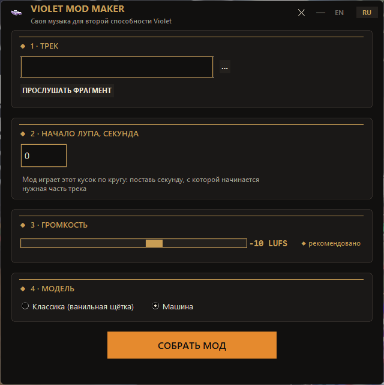

# Violet Mod Maker ◆

**RU** · [EN below](#english)

Собирает мод для [Deadlock](https://www.deadlockgame.com), который заменяет музыку
второй способности Violet на **ваш трек** и меняет модель (машина или ванильная
щётка). Никаких SDK и инструментов Valve не требуется — всё в одном exe.

<p align="center"></p>

## Возможности
- свой трек (mp3/wav) → зацикленный фрагмент 76 секунд с бесшовным кроссфейдом
- ручной выбор секунды начала лупа + прослушивание фрагмента
- нормализация громкости по ITU-R BS.1770 (LUFS), по умолчанию −10 — выверено в игре
- пресеты модели: Классика (ванильная щётка) / Машина; свои пресеты добавляются папкой
- автоматическая установка в игру (папка Steam ищется сама, включая доп. библиотеки)
- интерфейс RU / EN

## Как это работает
Игра читает только скомпилированные ресурсы Source 2, а компилятор Valve
перераспространять нельзя. Но скомпилированный звук (`.vsnd_c`) — это
фиксированный заголовок + сырой PCM16: приложение подставляет ваш PCM
в эталонный заголовок (скомпилированный один раз на эталонную длину лупа
76.000000 с), и игра принимает файл как «настоящий». Детали — в `app/vsnd.py`.

## Сборка из исходников
Нужен Python 3.10+:

```bat
pip install numpy miniaudio pyloudnorm pyinstaller
cd app
pyinstaller modmaker.spec --noconfirm --distpath ../dist
:: → dist\VioletModMaker.exe
```

Или просто скачайте готовый exe со страницы релизов (GameBanana / Releases).

## Установка мода
1. Соберите мод и выберите имя файла (по умолчанию `pak99_dir.vpk`)
2. Скопируйте его в `Steam/steamapps/common/Deadlock/game/citadel/addons/`
3. Перезапустите игру. В Sandbox выберите Violet, вторая способность — ваша музыка.

Одновременно можно держать несколько модов с разными номерами pak
(`pak98_dir.vpk`, `pak97_dir.vpk`…).

## Структура
```
app/
  main.py            # интерфейс (tkinter, Deadlock art-deco тема)
  audio.py           # декодирование, луп, кроссфейд, LUFS-нормализация
  vsnd.py            # сборка .vsnd_c без Valve-тулз
  vpk.py             # VPK v2 writer (чистый Python)
  presets/           # пресеты моделей (скомпилированные ресурсы)
  core/              # эталонный заголовок vsnd_c и скомпилированный soundevent
  modmaker.spec      # PyInstaller
assets/              # лого и скриншоты
```

## Лицензия
Код — MIT (см. [LICENSE](LICENSE)). Valve, Deadlock и все связанные названия —
торговые марки Valve Corporation. Этот проект не связан с Valve и не одобрен ею.
Авторские права на музыку, которую вы упаковываете в мод, остаются за их
владельцами — используйте только те треки, на которые у вас есть права.

---

<a name="english"></a>
# Violet Mod Maker (EN)

Builds a Deadlock mod that replaces the music of **Violet's ability 2** with
**your track** and switches the model (car or vanilla brush). No SDK or Valve
tools required — one standalone exe.

## Features
- your track (mp3/wav) → seamless 76-second loop with a crossfaded wrap
- manual loop-start second with an audio preview
- ITU-R BS.1770 loudness normalization (LUFS), −10 default, tuned in-game
- model presets: Classic (vanilla brush) / Car; drop-in custom presets
- automatic game installation (Steam library autodetection)
- RU / EN interface

## How it works
The game only loads compiled Source 2 resources, and Valve's compiler can't be
redistributed. A compiled sound (`.vsnd_c`) however is a fixed header + raw
PCM16: the app patches your PCM into a reference header compiled once for the
canonical 76.000000 s loop length, and the game accepts it as-is. See `app/vsnd.py`.

## Build
Python 3.10+:

```bat
pip install numpy miniaudio pyloudnorm pyinstaller
cd app
pyinstaller modmaker.spec --noconfirm --distpath ../dist
```

Or grab a ready exe from the Releases page.

## License
Code — MIT ([LICENSE](LICENSE)). Valve, Deadlock and all related names are
trademarks of Valve Corporation. Not affiliated with or endorsed by Valve.
Music you pack into mods stays under its own copyright — only use tracks you
have rights to.
